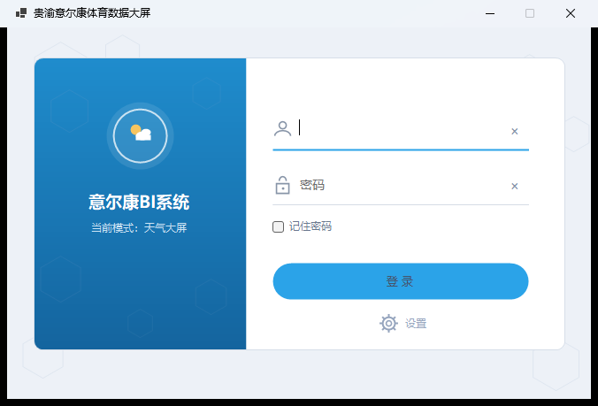
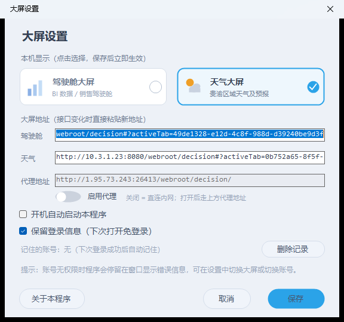

# 帆软BI数据大屏（DashboardKiosk）

Windows 大屏壳程序：用自带窗口全屏展示公司帆软 BI（FineReport，内网部署，地址不入库）的**驾驶舱大屏**和**天气大屏**，替代"开浏览器按 F11"方案。内置帆软风格登录窗、会话保持、开机自启、崩溃看门狗、公网代理切换。

**当前版本：v2.1.2**

## 功能特性

- 🖥️ **双大屏模式**：驾驶舱大屏 / 天气大屏，设置里二选一，地址均可随时修改
- 🔐 **内置登录窗**：帆软浅色风格自绘界面，支持记住密码、保持登录（免登录直接进全屏）
- 📺 **真全屏 Kiosk**：Esc / 双击 / 顶部悬停控制条切换全屏；崩溃自动被看门狗拉起
- 🌐 **公网代理开关**：默认直连内网；不在内网时可一键切换公网代理地址
- 🚀 **开机自启**：自启 + 自动登录 = 开机直接进大屏，全程无人值守
- 🔑 **自动登录**（v2.2.0）：设置勾选后，启动时检测到记住的账号就自动执行登录并进入全屏（类似 QQ），失败则停在登录窗提示原因
- 🧩 **4K / 高 DPI 适配**：手动 DPI 缩放方案，已在客户 3840×2160 @300% 环境实测

## 界面预览

**登录界面**：帆软浅色风格，左侧蓝色渐变品牌栏，右侧下划线输入行，下方齿轮"设置"入口



**大屏设置**：模式选择、两个大屏地址、代理开关（默认关闭，开启后走公网代理）、开机自启、保留登录、删除账号记录



> 全屏大屏内容为帆软 BI 实时页面，此处不放截图（涉及客户经营数据）。

## 技术栈

| 项 | 内容 |
|---|---|
| 语言 / 框架 | C# 12 · .NET 8 · WinForms（`net8.0-windows`） |
| 网页内核 | Microsoft WebView2 1.0.2903.40（系统 Edge 运行时） |
| 发布方式 | 自包含单文件 exe（目标机器无需装 .NET） |
| 安装包 | Inno Setup 7（脚本 `setup.iss`） |
| UI | 全中文、纯自绘控件（无图片资源依赖） |

## 快速开始

### 🤖 AI 快速接手（推荐）

把仓库里的 AI 技能包 `skills/yuerkang-dashboard/SKILL.md` 发给 AI 助手（WorkBuddy / Claude / Cursor 均可），AI 会自动拉取代码到本地。

```text
帮我接收这个项目。
代码仓库：https://github.com/RunWang925/gyyearconsports-dashboard.git
接手技能：<粘贴 skills/yuerkang-dashboard/SKILL.md 全文>
```

AI 接手后，直接和 AI 说明需求即可，修改、打包、交付都由 AI 完成。

### 环境要求

- Windows 10/11 x64
- [.NET 8 SDK](https://dotnet.microsoft.com/download/dotnet/8.0)
- WebView2 运行时（Win10/11 一般自带）
- （仅重做安装包需要）Inno Setup 7

### 编译运行

```bash
dotnet build            # 编译验证
dotnet run              # 本机直接运行
```

### 发布单文件 exe

```bash
dotnet publish -c Release -r win-x64 --self-contained true ^
  -p:PublishSingleFile=true ^
  -p:IncludeNativeLibrariesForSelfExtract=true ^
  -p:EnableCompressionInSingleFile=true
```

产物：`bin/Release/net8.0-windows/win-x64/publish/DashboardKiosk.exe`，单个 exe 即可运行（大屏地址已内置默认值）。

### 打安装包

用 Inno Setup 7 编译 `setup.iss`（记得同步改 `AppVersion` 与 csproj `<Version>` 一致），输出 `installer/意尔康大屏程序安装包.exe`。

## 目录结构

```
DashboardKiosk/
├── *.cs                  全部源码（Program 入口 / MainForm 核心 / 登录窗 / 设置弹窗 / DPI 缩放 / 看门狗等）
├── DashboardKiosk.csproj 项目文件（版本、图标嵌入、WebView2 引用）
├── setup.iss             Inno Setup 安装包脚本
├── Dpi.cs                高 DPI 手动缩放核心（IDpiSelfLayout 防二次缩放）
├── devtools/             开发辅助脚本（窗口截图等 UI 自动化工具）
├── skills/yuerkang-dashboard/   ★ AI 接手技能包（发给 AI 助手即可自动接手本项目）
├── docs/                 界面截图（login.png 登录窗 / settings.png 设置弹窗）
├── dist/
│   ├── 意尔康大屏程序安装包.exe   ★ 最终交付：安装版（v2.1.2）
│   └── 使用说明.txt              ★ 给最终用户的说明书
├── 开发维护手册.md        面向维护者：环境搭建、编译、打包、踩坑记录
├── AI_PROJECT_CONTEXT.md  AI 交接文档：架构、文件地图、核心链路、血泪坑
└── README.md             本文件
```

## 文档索引

| 文档 | 面向 | 内容 |
|---|---|---|
| [README.md](README.md) | 所有人 | 项目概览、快速开始 |
| [开发维护手册.md](开发维护手册.md) | 开发/维护人员 | 逐文件讲解、编译发布流程、DPI 与全屏踩坑实录 |
| [AI_PROJECT_CONTEXT.md](AI_PROJECT_CONTEXT.md) | AI / 新接手者 | 完整架构、文件地图、三条核心链路、配置 schema |
| [dist/使用说明.txt](dist/使用说明.txt) | 最终用户 | 安装、日常操作、常见问题、卸载 |

## 运行期数据（排障入口）

```
%LOCALAPPDATA%\YuErKangDashboard\
├── config.json        运行配置（模式/地址/代理开关）
├── settings.json      开机自启等开关
├── credentials.json   记住的账号（Base64 混淆）
├── logs\              按天日志（排障第一步看这里）
└── WebView2\          登录会话 Cookie
```

## 已知限制

- exe 未做代码签名，Windows 11「智能应用控制」可能拦截 → 解决办法见使用说明 FAQ。
  - **自用 / 客户内网机器**：关闭智能应用控制即可，无需签名，不影响使用；
  - **如需签名**（企业统一部署、想彻底消除系统提示）：购买代码签名证书（OV 约几百~上千元/年），用 `signtool` 给 exe 签名后重新打包，系统即不再拦截。
- 首次切换代理地址后需重新登录一次（帆软 Cookie 按域名隔离，预期行为）
